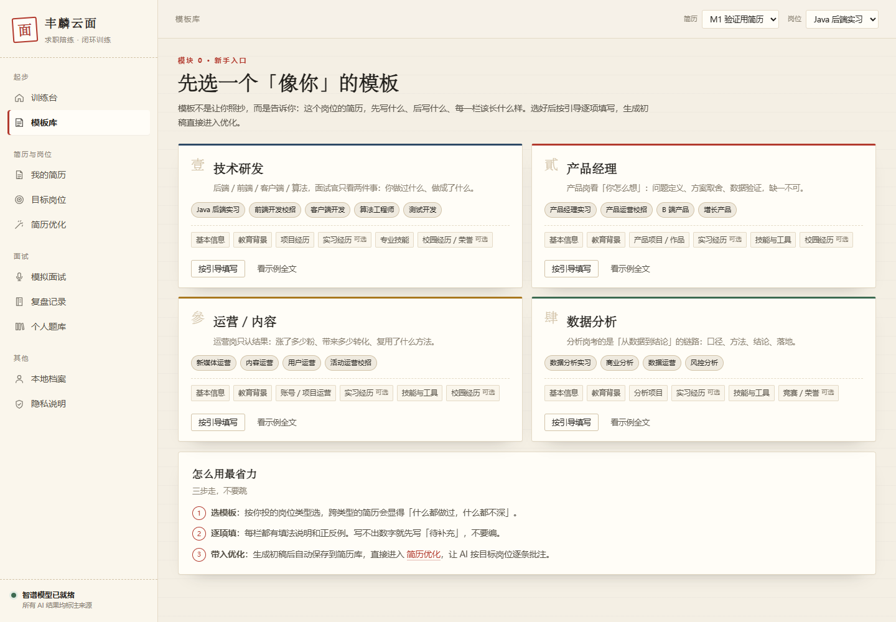
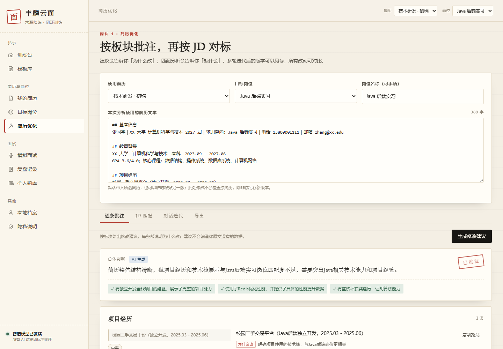
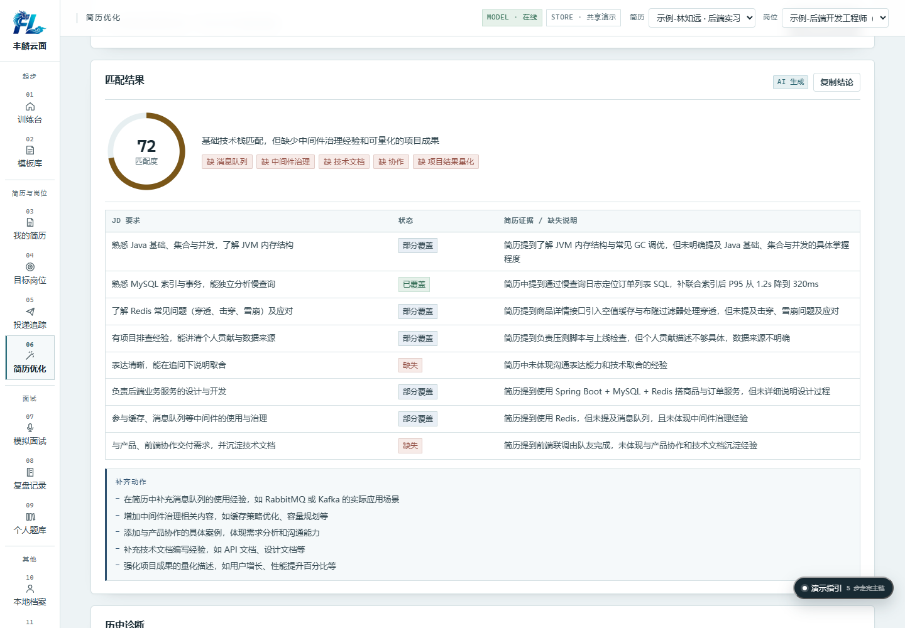
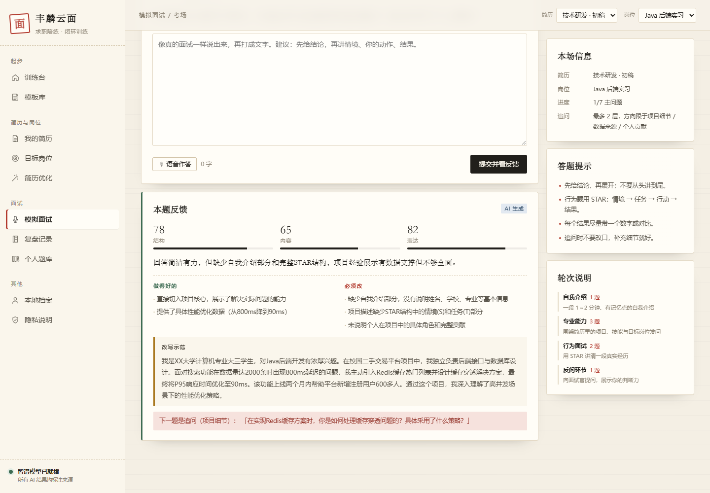
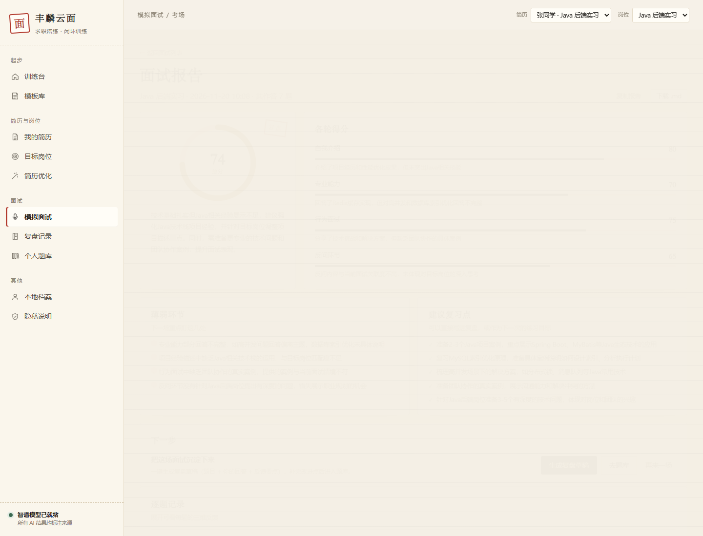
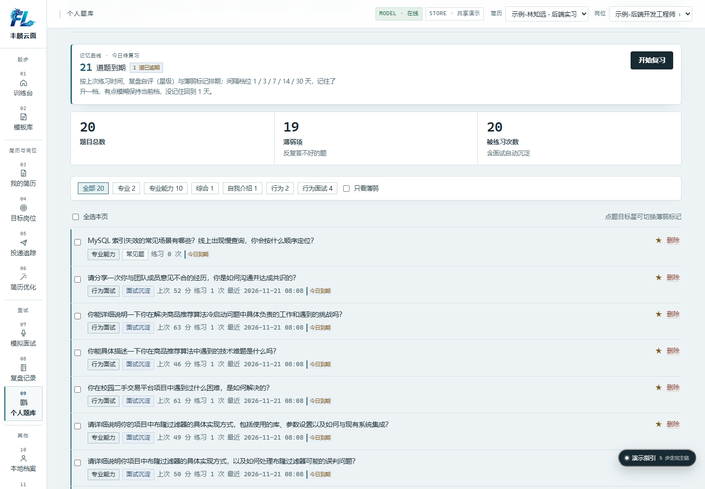
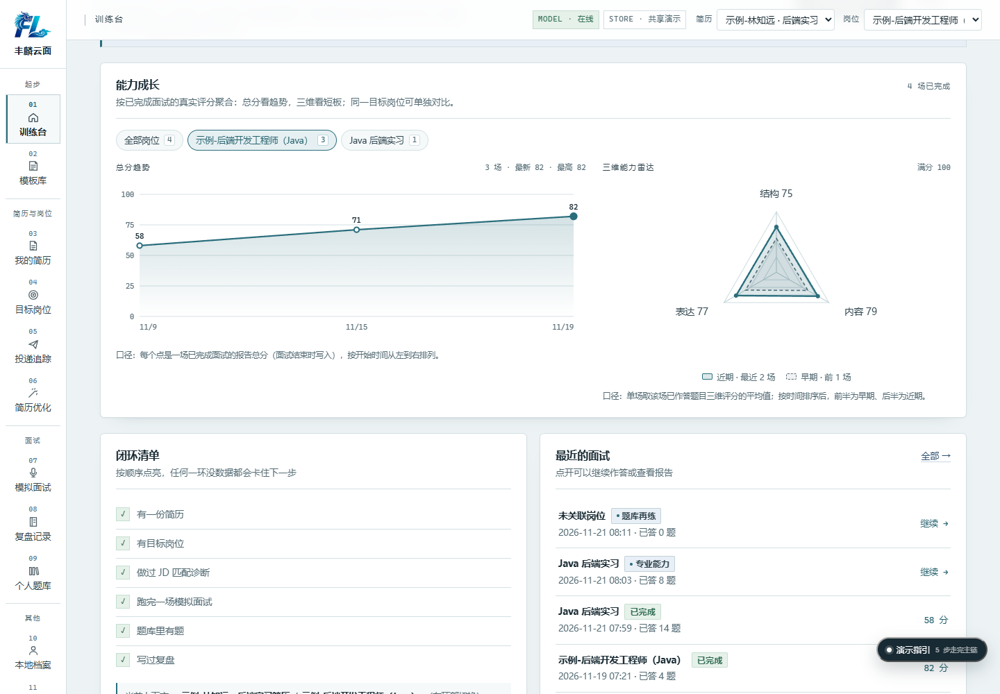
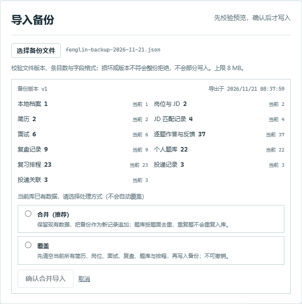
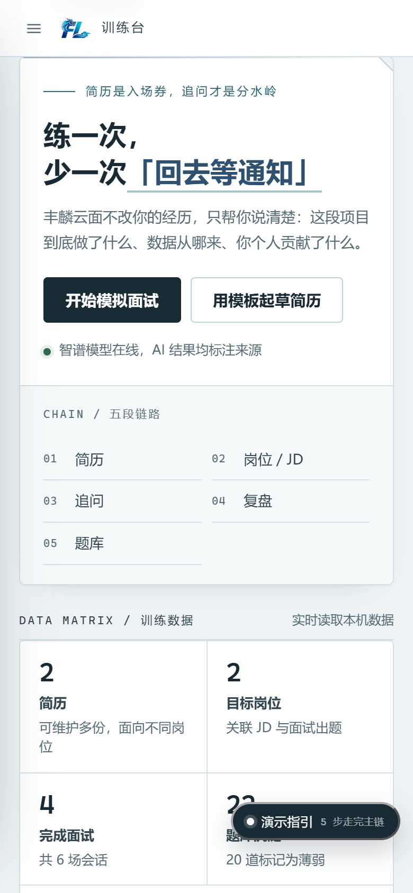

# 校园生活｜丰麟云面

## 帖子摘要

丰麟云面是一个面向大学生的求职陪练 Web 应用：把简历优化 → JD 匹配 → 从简历生成面试追问 → 模拟面试 → 复盘沉淀 → 题库再练串成一条闭环，解决简历和岗位对不上、面试只能空练的问题。我用 TRAE 从零完成前后端开发、真实浏览器全量测试与上线部署。

---

【类别】TRAE 大学生创造力大赛专区

【标签】校园生活

【限定】仅允许个人参赛，不组队

---

## 一、个人介绍（不计入评分，用于优秀作品展示）

我是大连东软信息学院软件工程专业（专升本）的大四学生，即将毕业，现在正在找工作，累计投递了 500+ 份简历。

**第一个用户是我自己。** 投完一堆简历之后，我打开自己记投递的那张表，常常分不清哪家已经参加过笔试、哪家进过面试、哪家投出去就再没消息——公司名字一行行排在那里，状态却停在投递那天，想跟进都不知道该从哪家开始。

**如果没有这个作品，我今天会怎么办：** 靠手机备忘、招聘 App 里的投递列表和聊天记录往回倒推。翻到哪条算哪条，提醒基本靠临时想起，跟进容易漏；面完之后也没有回头复盘，下一次面试还是从零开始准备。

**一个真实的数字：500+ 份简历。** 这个数字不是说工具能替我投多少，而是说明「投递」一旦上了量，只靠脑子和零散记录真的管不住。

---

## 二、产品简介

### 是什么

丰麟云面（Fenglin Cloud Interview）是一个跑在浏览器里的求职陪练应用。它不做招聘信息聚合，也不做「AI 一键生成完美简历」，而是盯住一个具体问题：**你手里有一份简历和一个想投的岗位，但两者对不上，面试也没有针对自己的简历练过。**

它把六步串成闭环：简历优化 → JD 匹配分析 → 从简历生成面试追问 → 模拟面试 → 面试复盘沉淀 → 题库再练习。每一步的产出都是下一步的输入，简历正文、目标岗位 JD、面试作答、复盘记录在模块间真实流转，不是六个互不相干的工具页。

### 面向谁

正在找实习和参加校招的大学生。三个典型场景：

- **投递前**：想知道自己的简历和目标岗位差在哪、缺哪些关键词；
- **面试前**：想按自己的简历做一次有针对性的模拟面试，而不是背通用题；
- **面试后**：想把答砸的问题记下来，过几天再练一遍，而不是面完就忘。

### 这个作品从哪来

它不是先想功能再找场景。我自己累计投了 500+ 份简历，投完常常分不清哪家已经笔试、哪家进过面试、哪家没有消息，跟进和复盘都在漏。产品里的投递追踪就来自这段经历；其余模块对应的是投递前后真正卡住的地方——简历和岗位对不上、面试没有按自己的简历练过、面完不回头。

### 功能清单与使用路径

**模块 0 · 新手入口：模板库与我的简历**
没有简历也能开始。模板库按岗位分四套（技术研发 / 产品经理 / 运营·内容 / 数据分析），点「按引导填写」逐栏写，每栏都有正反例和实时预览，卡住可以先用「AI 润色初稿」，最后点「生成初版简历」直接进入优化。已有简历则在「我的简历」里新建，或导入 .md / .txt、导入 PDF / 图片——电子版 PDF 在本地抽文字，扫描件交给视觉模型识别；单文件不超过 10MB，扫描件最多前 3 页。

*四套岗位模板，从零也能起草第一版简历。*

**模块 1 · 简历优化：批注、匹配、迭代、导出**
优化页是三栏工作台（01 JD / 02 原稿 / 03 建议），四个页签分工清楚：「逐条批注」点「生成修改建议」，按板块逐条说清「为什么改」，只改写法、不替你编数据，每条建议可以「应用到草稿」并逐条撤销；「JD 匹配」点「开始匹配分析」，给出匹配分、缺失关键词、逐条要求的已覆盖 / 部分覆盖 / 缺失对照和补齐动作，多次分析留在「历史诊断」；「对话迭代」可以继续提要求，点「对比原始」看行级增删；「导出」能下载 .md、下载 Word（.docx），或打印 / 存为 PDF，草稿与已保存版本不一致时会先提示「当前草稿未保存」，避免导出旧版本。「我的简历」里用 `parentId` 记录版本派生关系，可以并排对比任意两版（`/resumes/compare`）。侧栏「简历与岗位 → 经历素材」把项目或实习拆成 STAR 卡片，模板填写、简历优化和面试出题三处都能调用；岗位详情里的「技能图谱」把 JD 拆成技能标签，并按权重给出当前简历的覆盖率。JD 的抓取入口在「目标岗位 → 新建岗位」弹窗的「从招聘页面抓取」：粘贴公开招聘页链接后点「解析链接」，成功后先显示抓取字数、确认后才保存，失败会说明原因并保留原来的 JD；保存后可「设为当前」或「做匹配分析」。

*每条建议都写明改法，并解释为什么要改。*

*对着 JD 打分，并列出已覆盖与缺失的关键词。*

**模块 2 · 模拟面试：出题、考场、报告**
新建面试可四选一：只用简历题 / 简历 + 常见题 / 只用常见题 / 从题库再练。常见题共 60 道、按五个岗位方向整理，界面写明来源是社区常见题型，不是任何公司的真题。建面还能选面试预设（标准面 / HR 面 / 压力面 / 行为面，轮次、题量、追问阈值与反馈语气会跟着变）和语言（中文或 English）；英文模式下题目、四轮名称、三维反馈、报告、朗读与语音识别都切英文，中文常见题与题库入口会禁用。考场四轮推进（自我介绍 → 专业能力 → 行为面试 → 反问）：题目可以「▶ 朗读题目」并按语速朗读；每轮限时 60 / 150 / 120 / 90 秒，最后 30 秒变色，到点只提交已经写下的内容；作答支持文字与语音，点「提交并看反馈」得到结构 / 内容 / 表达三维评分、「做得好的」「必须改」与改写示范，分数不够会追问，最多两层；反问轮不套 STAR，改用「问题相关性 / 信息获取价值 / 岗位理解」评分；常见题反馈卡上可以「加入个人题库」。单题反馈与整场报告都是异步任务：接口先返回 202 与 jobId，页面显示生成进度并轮询结果，长回答不会被平台网关的 30 秒上限截断；同一题重复提交会被 409 挡回，不会生成两份反馈。整场结束生成报告：总分、各轮得分、薄弱环节、建议复习点和逐题记录，可复制或下载 .md，也能导出单文件分享快照或一键「生成复盘草稿」。侧栏「面试 → 自我介绍」还会读取当前简历、目标岗位与 STAR 素材，生成 60 / 90 / 120 秒三版背稿卡，可逐版修改、朗读与计时。

*同一道题按结构、内容、表达分别给分并示范。*

*整场结束给出总分、各轮得分与复习建议。*

**模块 3 · 复盘、个人题库与记忆曲线**
报告页的「生成复盘草稿」会把题目、你的回答和反馈要点带到复盘记录，补上改进点就能长期复习；生成时可以勾选「含追问一起生成」，追问条目会带「模拟面试·追问」标签。复盘带岗位标签、可以搜索，支持编辑、加入题库，也能单独导出 Markdown / Word 或打印。个人题库会标注来源（面试沉淀 / 复盘加入 / 常见题 / 手动添加），支持薄弱筛选、搜索、行内编辑与勾选后再练；任意一题还能生成「解析卡」，把考察点、回答框架、示例、易错点和追问方向整理成一页，可复制带走。顶部的「记忆曲线 · 今日待复习」按 1 / 3 / 7 / 14 / 30 天排期，点「开始复习」先自己作答（可写下来，也可让 AI 给改进点），提交后与上次得分对比，再选「记住了」升一档、「有点模糊」保持当前档、「没记住」回到 1 天；复习时写的内容只用于本次对比，不覆盖题库里的原回答。

*到期题按间隔档位自动排进今日复习。*

**投递追踪（独立页面）**
侧栏「简历与岗位 → 投递追踪」专门记录你实际投出去的每一次申请：阶段覆盖已投递 / 笔试 / 一面 / 二面 / HR 面 / 已发 offer / 已拒 / 自己放弃。页面可以在列表 / 看板 / 日历三种视图之间切换：列表看明细，看板按阶段分列并显示各阶段数量，日历把投递日、下次跟进、岗位截止和阶段变化排在同一个月里，顶部还有「今日跟进」汇总条。顶部给出投递总数、进入面试、已发 offer、进行中与已结束，以及面试和 offer 的转化概览——漏斗按阶段历史计算，每次阶段变化都会追加一条记录，不再只看当前阶段；每条投递可设下次跟进日期，当天到期的会出现在训练台「今日需跟进」。「查看详情」里能把某场模拟面试和复盘关联到这条投递上，也能按关联记录筛选，或只留一条独立记录。

**训练台与求职档案**
训练台首页把闭环摊开：能力成长给出总分趋势与结构 / 内容 / 表达三维雷达，下面是「今日需跟进」「今日计划」、数据矩阵、闭环清单和最近的面试。每交完一份面试报告，系统会按薄弱项、复习点、到期复习和投递跟进生成未来七天的训练任务，每天最多 3 条；「今日计划」可以直接勾选完成，侧栏「面试 → 7 天计划」能看整周安排。侧栏「其他 → 求职周报」把本周面试场次与平均分（含环比）、新增投递、阶段推进、复盘与题库新增、计划完成度汇总成一页，可复制 Markdown 或打印。训练台的「生成求职档案 PDF」会把个人与目标岗位、简历要点、面试成绩、复盘与题库薄弱项、成长趋势合成封面 + 5 章，用浏览器打印即可存成 PDF，也可以直接下载 docx；面试报告同样支持 docx 与打印页 `/print/interview/:id`。面试报告和求职档案都能「导出分享快照」，得到一个完全自包含的单文件 HTML（无脚本、无外链），对方离线双击就能看，导出前会提示文件可能含个人信息。

*同一岗位有足够面试后才画趋势，能看到变化。*

**示例数据与演示模式**
首次打开可以「载入示例档案」先看效果；右下角「演示指引」用 5 步走完主链，是浮动卡片，不挡操作、随时可退；「清空示例数据」只删「示例-」开头的记录，不动你自己创建的。

**数据备份**
「数据备份」页可以「导出 JSON 备份」，一个文件装下档案、简历、岗位与 JD、匹配记录、面试与反馈、复盘、题库、复习排程，以及投递阶段历史（当前格式 v2，导入仍兼容旧的 v1 备份）；导入时先看版本与条目数，再选「合并（推荐）」或「覆盖」，写库是单事务；选覆盖前必须先导出当前数据并勾选「我已备份」。如果超过 7 天没有导出，或累计 10 次写操作都没导出，首页会提示备份，可以忽略 3 天。

*导入前先看版本与条目，再决定合并还是覆盖。*

**本地档案、隐私与可达性**
全站不做注册登录，进度只存在当前实例；隐私说明页写清模型外发范围与共享演示的限制。手机宽度整页可读、没有横向溢出，键盘第一下能「跳到主要内容」，加载时先出骨架屏而不是白屏。

**建议的使用路径**：在模板库起草一份简历（或从「我的简历」导入）→ 到「目标岗位」新建岗位、贴链接抓 JD → 回「简历优化」先出逐条批注、再做 JD 匹配 → 用这份简历开一场模拟面试，作答、看反馈与追问 → 报告页看薄弱环节并生成复盘草稿 → 把反复答不好的题放进个人题库，按记忆曲线复习再练 → 交完报告后照「7 天计划」每天做 1–3 条，周末在「求职周报」看本周推进。每真正投出一份，就在「投递追踪」记一条，把这场模拟面试和复盘挂上去；要交材料时，回训练台生成求职档案 PDF 或分享快照。

*手机宽度下整页可读，没有横向溢出。*

### 配图清单

发帖时按以下顺序上传 `screenshots/` 目录里的 9 张图：

1. `desktop-templates.png` —— 模板库
2. `flow-03-optimize-advice.png` —— 逐条修改建议
3. `flow-04-optimize-match.png` —— JD 匹配
4. `flow-06-interview-feedback.png` —— 面试三维反馈
5. `flow-11-report-full.png` —— 面试报告
6. `home-today-review.png` —— 题库今日复习
7. `home-growth-radar.png` —— 成长曲线与雷达
8. `backup-import-preview.png` —— 备份导入预览
9. `mobile-home.png` —— 移动端首页

---

## 三、体验地址

**在线体验（公开，无需登录，无需注册）**
https://37kt7qk05rsihxps0fr.traesite.cn

- 发布方式：用 TRAE 插件市场的「一键部署」发布，站点可见性为 public，任何人可直接打开；
- 站内已带示例数据，打开就能走完整条链路，不用先填一堆内容；
- 模型调用在服务端完成，浏览器端不接触密钥。

**需要提前说明的托管限制（不粉饰）**：这个在线版是演示环境，容器没有持久卷，**站点重启或重新部署后站内数据会被清空**，且所有访客共享同一份数据。只想体验功能直接用即可；想保留自己的简历、面试与复盘记录，请用站内的「数据备份」导出 JSON，下次再导入；需要长期保存，也可以在本地运行（代码与启动方式见作品说明）。

---

## 四、演示视频

- 文件：`2026-11-20/fenglin-mianshi/outputs/video/丰麟云面-演示视频-v2.mp4`
- 时长 **4 分 42.96 秒**（72,136,009 字节），1920×1080，25 fps，H.264 + AAC，画面 + 硬字幕 + 中文旁白
- 字幕：`丰麟云面-演示视频-v2.srt`（59 条，时间码与成片一致）；旁白稿：`旁白稿-v2.md`（18 段，一段对应一个分镜）
- 分镜依据：`演示视频分镜脚本-v2.md`（18 个分镜，逐段标注画面操作、字幕与旁白）
- 录制与参数：`录制说明-v2.md`（时间轴、变速、响度、抽帧检查与已知限制）
- 在线观看链接：**（待粘贴链接）**

视频是在真实浏览器里操作线上站点录的，不是静态截图拼贴；模型生成等待也保留在画面里，只在字幕中标注了「等待已加速」的段落。旁白由系统中文语音合成（Microsoft Huihui），朗读题目的真实语音未录入，原因在录制说明里写明。旧版 4 分 26 秒静音版与机器旁白版仍保留在 `video/` 目录，仅作历史版本，提交以 v2 为准。

| 时间 | 展示内容 | 亮点 |
|---|---|---|
| 0:00–0:50 | 训练台成长曲线与三维雷达 → 数据矩阵与闭环清单 → 模板库起草简历 | 同一岗位至少两场面试才画趋势，只有一场时不硬画 |
| 0:50–1:57 | 逐条批注「为什么改」→ 新建岗位抓 JD → JD 匹配 72 分与「要求—证据」对照 → 对话改稿与导出 Word | 每条建议都给理由；抓取结果确认后才写库 |
| 1:57–3:00 | 四种出题方式 → 考场（朗读、限时、作答、三维反馈、追问、常见题入库）→ 面试报告 | 朗读、限时、追问都是真实运行，不是预置结果 |
| 3:00–3:46 | 一键生成复盘 → 记忆曲线复习与题库再练 → 投递追踪 | 复盘和题库能反哺再练，投递可关联当次面试与复盘 |
| 3:46–4:12 | 求职档案 PDF（封面 + 5 章节）→ 数据备份导出与导入预览 | 没有账号体系，用文件备份兜住数据 |
| 4:12–4:42.96 | 演示指引与示例数据 → 移动端 390 宽、骨架屏、键盘可达 → 结尾与 LOGO 卡 | 手机宽度可完整作答，无横向溢出 |

---

## 五、TRAE 实践过程

这个作品从需求梳理到上线，主要是在 TRAE 里完成的。技术选型是前端 React 18 + TypeScript + Vite 6、样式全部手写 CSS（不引 UI 库）、后端 Express 4 单进程、用 sql.js 做 SQLite 持久化，模型接的是智谱 `glm-4-air`（文本）与 `glm-4v-flash`（简历图片识别）。下面是实际走过的步骤。

**1. 需求拆解与比赛规则梳理**
先把「求职陪练」拆成可交付的模块边界，确认哪些是主链、哪些是可延后能力，再对照比赛要求逐条核对交付物（在线地址、演示视频、实践过程截图、Session 记录）。这一步产出了模块 0–4 的划分和一份功能地图，后面开发一直按它推进。

**2. 模块化开发**
按模块推进：先做模板库与简历优化，再做模拟面试与复盘题库，最后补档案、备份与训练台。前端每个路由一个页面，后端按 core / ai / interview / review / backup 拆路由。模型调用统一走服务端，输出用 zod 校验结构，失败最多重试 3 次，超时 55 秒；模型不可用时，JD 匹配、出题、单题反馈与报告切本地规则并标注「本地降级」，没有可靠本地等价物的能力则返回结构化错误由页面提示重试，不白屏。

**3. 真实浏览器全量点击测试与缺陷修复**
不是只看接口返回 200，而是用真实浏览器把每条主链点一遍：模板 → 简历 → 建议 → JD 匹配 → 面试 → 报告 → 复盘 → 题库 → 再练，逐页检查布局、控制台报错与窄屏溢出，发现的问题当场修复再复跑。桌面按 1440 宽度、手机按 390 宽度各走一遍，确认没有横向溢出。

**4. 部署上线**
最初用原生 SQLite 驱动，在托管环境连续踩到两个坑：构建机与运行时的 Node ABI 不一致，换成预编译二进制后又缺 glibc 版本。最后改用 sql.js（SQLite 的 WebAssembly 版），只重写数据层一个文件，表结构与 SQL 不变，路由零改动。部署用插件市场「一键部署」发布为单个 Node 进程，静态文件与 `/api` 同端口，密钥只放服务端环境变量；上线后检查过线上 JS 产物，不含密钥字符串。

**5. 视觉重做**
功能跑通后做了一轮视觉重做：把配色、字号、间距收敛成统一的设计 token，标题用宋体字族，页面做成 1180 / 980 / 640 三档响应式；同时补了骨架屏与无障碍细节，避免加载时白屏和窄屏挤压。

**6. 上线后的稳定性加固（P0）**
上线跑真实链路后，先做了一轮止损而不是继续堆功能：把单题反馈与整场报告从同步请求改成异步任务（`202 + jobId` + 轮询），避开平台约 30 秒的网关截断；作答与出报告互斥，用原子占位与状态条件把并发重复提交挡成 `409`。删除面试 / 复盘时同步清理投递关联，不再留孤儿行；读接口只查缺失项、`db.run` 仅在真正改动行时落盘，并补齐 12 个索引；首页改路由级懒加载并拆出 `vendor-react`，首屏三个文件 gzip 从约 130.3 KB 降到约 83.8 KB。另外加了按 IP 的分钟 / 每日双阈值限流（`/ai/status` 豁免），作答草稿按「面试 + 题目」自动保存可恢复，限时改按真实时间戳计算，覆盖导入前必须先导出并勾选「我已备份」，补了路由级错误边界与首次 AI 外发门禁。

**7. 闭环补全（P1）**
P0 稳住之后补的是「改得动、查得到、导得出」：投递加了阶段历史表，漏斗按历史口径算，每条投递可设跟进日期并在训练台「今日需跟进」提醒；简历加了 `parentId` 版本谱系和 `/resumes/compare` 并排对比；面试、复盘、题库、诊断历史都改成游标分页并支持筛选；AI 任务状态落 `ai_job` 表，刷新或重启后还能继续轮询，轮询改成指数退避、请求带超时，任务可恢复也可在前端取消；报告与档案补了 docx 与打印页 `/print/interview/:id`；新增 `/api/bootstrap` 聚合并给成长、档案聚合加了进程内缓存；建议可逐条应用到草稿并撤销，导出前校验草稿是否已保存，题库支持搜索、行内编辑与批量标薄弱，投递可按关联记录筛选，移动端把主操作固定在底部。

**8. 数据复用与差异化模块（P2 / P3）**
P2 先把已有数据用起来：经历素材拆成 STAR 卡片，模板填写、简历优化与面试出题三处复用；岗位技能图谱从 JD 提技能标签并算简历覆盖率；自我介绍生成 60 / 90 / 120 秒三版；题库任意题可生成解析卡；考场补了换一题，简历版本对比也能复制差异。P3 再做「别人没有」的训练体验：报告提交后按薄弱项、复习点、到期复习与投递跟进生成 7 天计划，每天最多 3 条，首页可勾选、`/plan` 看整周；投递页加列表 / 看板 / 日历三视图与今日跟进条，`/api/applications/calendar` 聚合投递日、跟进、截止与阶段变化；`/api/reports/weekly` 生成求职周报（面试场次与平均分含环比、新增投递、阶段推进、复盘与题库新增、计划完成度），可复制 Markdown 或 `/print/weekly` 打印；面试支持中 / 英双语与标准面 / HR 面 / 压力面 / 行为面预设，英文模式禁用中文常见题与题库入口；反问轮改用「问题相关性 / 信息获取价值 / 岗位理解」评分；生成复盘时可选含追问；题库复习改成先作答再对比上次得分（作答不落库）；首页加备份提醒（7 天或 10 次写入未导出，可忽略 3 天）；面试报告与求职档案可导出无脚本、无外链的单文件 HTML 分享快照。

**9. 文档与演示视频**
最后补齐 README、部署说明、截图清单与演示视频分镜脚本，按 18 个分镜在线上站点实拍录屏，统一到 1920×1080 / 25 fps，烧录 59 条中文字幕并混入 18 段中文旁白。分镜脚本里逐段写清了哪些等待被加速、哪些是真实等待，避免把功能演示剪成「瞬间返回」。

### 关键步骤截图（≥3 张）

> 截图尚在整理，以下位置先留占位，发帖前替换为真实图片。

- 截图 1：**（待插入）** 建议内容：TRAE 会话里拆解模块与功能地图的画面
- 截图 2：**（待插入）** 建议内容：TRAE 里实现某个模块（如模拟面试作答与反馈）的编辑与产物
- 截图 3：**（待插入）** 建议内容：真实浏览器点击测试或部署上线后的线上页面
- 截图 4（可选）：**（待插入）** 建议内容：部署记录与线上站点首次打开

已在 `outputs/screenshots/` 准备了 23 张截图（7 张精选 + 16 张新增能力，桌面 1440 宽、移动 390 宽），其中首页、模板库、逐条建议、JD 匹配、面试反馈、面试报告、移动端首页 7 张可作为作品展示图，但它们是成品界面，不能替代上面要求的过程截图。

### 关键任务 Session ID（≥3 个）

- Session ID 1：`b7197e3d66211a5112f9ece4` —— 主开发与部署会话（搭建模块 0–4、接入模型、全链路自测、改用 sql.js 并部署）
- Session ID 2：`6aff9eb67122f9d2534fbfb1` —— 部署与账号体系判定协作会话（指定一键部署、约束密钥与公开访问、判定不做注册登录）
- Session ID 3：`7f077dbf56533a1e89f405dd` —— 丰麟云面 全站点击测试（真实浏览器逐页点击、缺陷修复与截图归档）

说明：三个 ID 均在本地 TRAE 会话记录中核对过。第 3 个对应标题「丰麟云面 全站点击测试」的会话，已按会话创建与标题更新日志确认其 ID，且与上面两个不重复。

---

## 发帖前需补齐

- [ ] 关键步骤截图 **不少于 3 张**，替换文中「（待插入）」占位（建议 4 张，含部署上线）；
- [ ] 演示视频上传到视频平台后，把链接填到「在线观看链接：（待粘贴链接）」；
- [ ] 发帖前再打开一次体验地址，确认可访问、示例数据能载入。